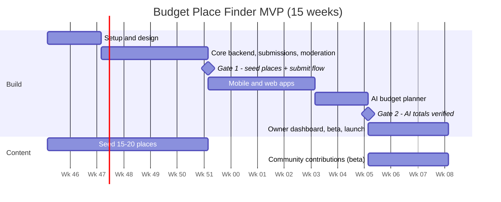

# Budget Place Finder — Development Plan

**Stack:** Flutter (mobile) · React + TypeScript (web, owner and admin dashboards) · Node.js + TypeScript API · PostgreSQL (+ PostGIS, pg_trgm) · Cloudflare R2 (S3-compatible storage) · Gemini API

**Content model:** community-driven. You add 15–20 seed places yourself. After that, anyone with a verified account can add places, photos, menus and reviews (including what they paid). Every submission goes through AI screening and admin approval before it goes public. Trusted contributors' reviews, photos and edits to existing places publish automatically and are spot-checked.

The MVP takes about **15 weeks** for one full-time developer. Two gates must pass before moving on:

1. **Gate 1:** the seed places are in, and the full submit → AI screen → approve flow works end to end, before you build the apps.
2. **Gate 2:** AI totals always match the database, before the beta.

A second developer on Flutter could cut weeks 7–10 roughly in half.

---

## Roadmap at a glance

| Phase | Weeks | Focus | Ends with |
| --- | --- | --- | --- |
| 1. Setup and design | 1–2 | Schema, CI, R2, wireframes, terms, start seed places | Repos, database and designs ready |
| 2. Core backend, submissions and moderation | 3–6 | Auth, CRUD API, submissions API, AI screening, moderation queue, trust levels | **Gate 1:** seed places + submit flow working |
| 3. Mobile and web apps | 7–10 | Browse and search, contribute flows, offline drafts | Users can browse and contribute on mobile and web |
| 4. AI budget planner | 11–12 | Parse, query, rank, validate, save and share | **Gate 2:** AI totals verified |
| 5. Owner dashboard, beta and launch | 13–15 | Owner tools, points and badges, 50-user beta, launch | Public launch |
| After launch | Months 4–6 | Payments, featured listings, deals, contributor rewards, iOS | First revenue |

> The Gantt start date (16 Nov 2026) is only an example. Change it to your real start date.

---

## Phase 1: Setup and design (weeks 1–2)

- [ ] Set up a monorepo or three repos (`api`, `web`, `mobile`), with GitHub Actions for lint, test and build
- [ ] Write the PostgreSQL schema and Prisma migrations, including `submissions`, `contributor_stats` and `moderation_log`; seed areas, categories and tags
- [ ] Create the R2 bucket, API token, CORS rules and a custom image domain
- [ ] Draw Figma wireframes: home, list, place detail, menu, AI chat, add place, add menu, review, my contributions, moderation queue, owner dashboard
- [ ] Draft the terms of use and content guidelines (photo licence, what gets rejected)
- [ ] Pick the launch area (e.g. Woodlands or Kabulonga) and start visiting the 15–20 seed places: photos, menus, hours

## Phase 2: Core backend, submissions and moderation (weeks 3–6)

- [ ] Auth: phone OTP (required to contribute), email + password, JWT + refresh tokens, roles and trust levels
- [ ] REST endpoints: places, menus, search, filters, favourites, reviews
- [ ] Presigned upload flow to R2, plus a resize job that makes 400 px and 800 px WebP versions; strip location metadata
- [ ] Submissions API: create, list my submissions, approve, reject with a reason, edit-then-approve; on approval, write into the real tables
- [ ] AI screening pipeline: photo check, text check, menu plausibility, duplicate check, `ai_score`
- [ ] Gemini menu extraction from photos into an editable draft
- [ ] Trust rules: auto-publish for trusted contributors, promotion and demotion, rate limits
- [ ] React admin panel: mobile-friendly moderation queue, batch approve, merge duplicates, place editor, audit log
- [ ] Enter the 15–20 seed places and run 20 test submissions end to end (**Gate 1**)

## Phase 3: Mobile and web apps (weeks 7–10)

- [ ] Flutter: home by area, place list, filters and sort, place detail, gallery, menu, reviews, favourites
- [ ] Flutter contribute flows: add place (with duplicate check), menu by photo, upload photos, review with amount paid, suggest an edit, flag content, and a "My contributions" screen
- [ ] Flutter: offline cache and offline submission drafts, low-data image loading, call / WhatsApp / directions buttons
- [ ] React web: public home, search results, server-rendered place pages with SEO tags, and the same contribute flows
- [ ] Shared API client and design tokens so the app and site look the same
- [ ] Analytics events (view, menu view, call, directions) into `place_events`

## Phase 4: AI budget planner (weeks 11–12)

- [ ] Parse step: Gemini JSON output, falling back to profile defaults
- [ ] Candidate SQL query, plus a bundle builder in code, adjusted by the real amounts paid in reviews (totals are never calculated by the AI)
- [ ] Rank step, validation, fallbacks, daily limits, caching and `ai_requests` logging
- [ ] Chat UI in Flutter and React; save and share plans (link and WhatsApp)
- [ ] Test on 100 realistic prompts; every total must match the database (**Gate 2**)

## Phase 5: Owner dashboard, beta and launch (weeks 13–15)

- [ ] Owner claim flow, menu and photo editing, replies to reviews, basic stats
- [ ] Points, badges and area leaderboards
- [ ] Closed beta with 50 students and young professionals who both use the app and contribute; aim for 100+ approved community places by the end of the beta
- [ ] Privacy policy, terms of use, data deletion flow, takedown process (Data Protection Act No. 3 of 2021)
- [ ] Publish the Android app on Google Play; launch the web app on a custom domain
- [ ] Launch push: contributor challenge with campus ambassadors (e.g. add 5 places, win airtime), TikTok and Instagram date-idea videos, partner restaurants sharing their listings

## After launch (months 4–6)

- [ ] Mobile money payments (MTN MoMo, Airtel Money) for featured listings and deals
- [ ] Contributor rewards (airtime, partner deals), funded from featured listings
- [ ] Deals and multi-stop plans
- [ ] iOS release
- [ ] Second and third Lusaka areas, then Kitwe or Ndola, opened up by local contributors
- [ ] Bemba and Nyanja support in the AI planner

---

## Moderation workload plan

| Stage | Expected volume | How you keep up |
| --- | --- | --- |
| Beta | Tens of submissions a day | Review everything yourself on your phone, sorted by AI score |
| First months after launch | Up to a few hundred a day | Batch-approve low-risk items; trusted contributors auto-publish |
| Growth | More than you can handle alone | Promote 1–2 reliable contributors to moderators, or hire a part-time moderator |

Volumes are rough planning guides, not forecasts.

---

## Monthly running costs to budget for at MVP

- Hosting for the API and database (Railway, Render, DigitalOcean or a VPS)
- Web hosting (Vercel or Cloudflare Pages; free tiers usually cover the MVP)
- Cloudflare R2 storage (free tier covers the first 10 GB; no egress fees)
- Gemini API usage (planner plus screening every submission)
- SMS for OTP sign-in and contributor verification
- Google Play one-time developer fee
- Domain name
- Contributor rewards (from month 4)

Check current prices for each of these before launch.
